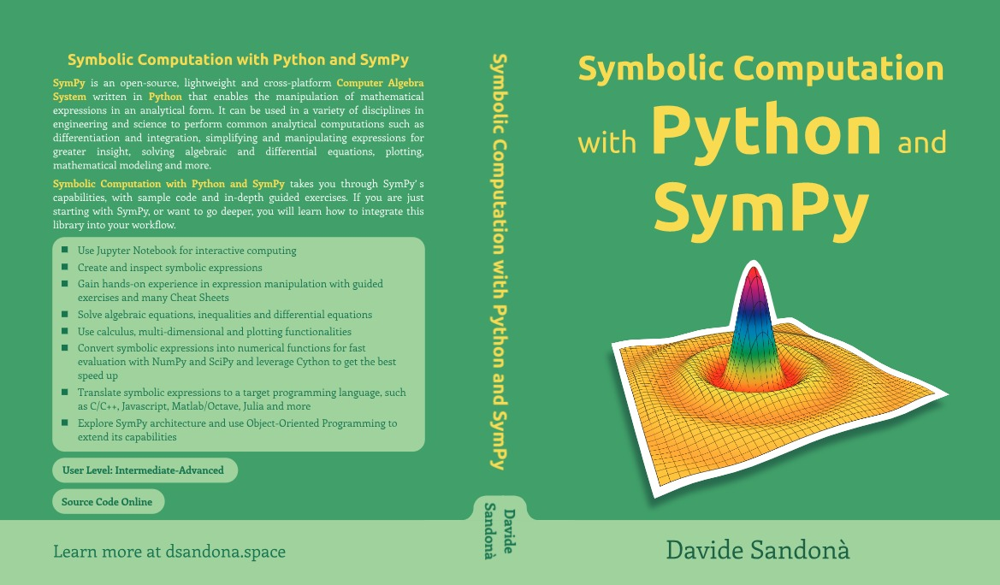
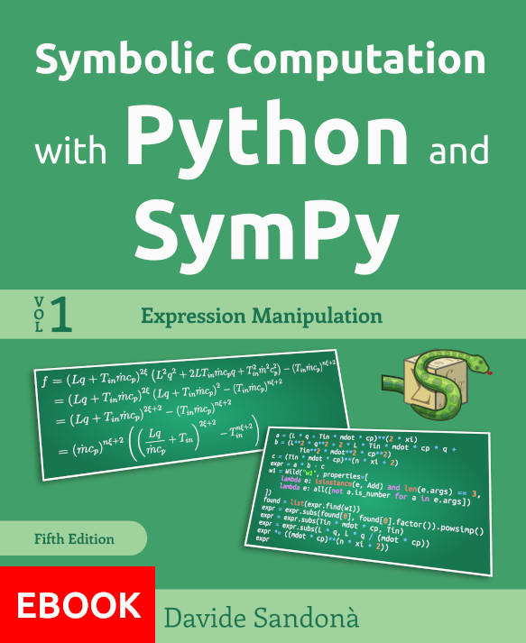
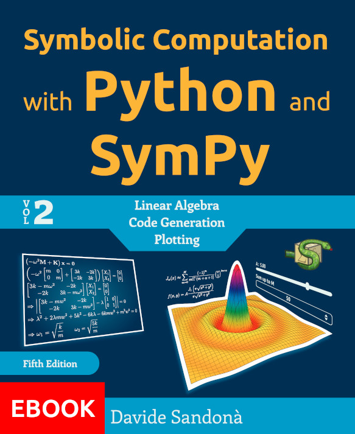
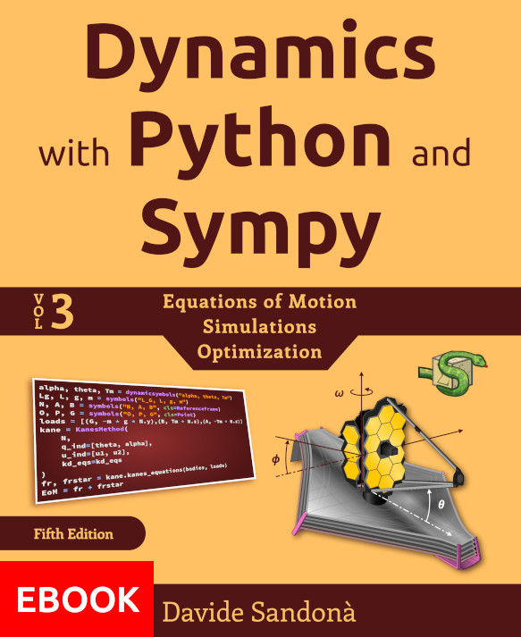

# Symbolic Computation with Python and SymPy

This repository contains the necessary Jupyter Notebooks and code to follow the book **"Symbolic Computation with Python and [SymPy](https://github.com/sympy/sympy/)"**, which can be purchased at **Amazon**: it is available in all amazon markets (COM, DE, IT, UK, ...).
  * [Printed Version](https://www.amazon.com/dp/B09HJ1WZ7K)
    

      
    

  * Ebook: for publishing reasons, the printed book had to be splitted in three volumes. Vol 1 + Vol 2 + Vol 3 = Printed Book.
    * [Volume 1 - Expression Manipulation](https://www.amazon.com/dp/B09HV4RQFS)
    * [Volume 2 - Linear Algebra, Plotting and Code Generation](https://www.amazon.com/dp/B09HV9QQCL)
    * [Volume 3 - Equations of Motion, Simulations, Optimization](https://www.amazon.com/dp/B0DK7YVVVH)
      

        
        
        
      

Please, read the [preview](assets/preview-fifth-edition.pdf) to understand what this book offers and who should read it.

## Updates

As time passes, new versions of the packages are going to be released, which may or may not be compatible with what was available when this book was written.

Here is a list of known changes:

1. Chapter 1, sub-section **"Setting up Nbextensions"**. It appears that `jupyter_contrib_nbextensions` is no longer compatible with newer version of Jupyter Notebook. You can safely skip this section, and you will still be able to continue with the Book.
2. Chapter 1, sub-section **"Installing the Algebra with SymPy module"**. Instead of installing `Algebra-with-SymPy`, install the [sympy_equation](https://sympy-equation.readthedocs.io/en/stable/index.html) module with one of these commands:

   `pip install sympy_equation` or `conda install conda-forge::sympy_equation`.

   This allows you to use the latest SymPy version.

## Editions

This repository contains the material associated with the **fifth edition** of the book. The notebooks associated to the previous editions can be downloaded from the **Releases** page, which can be found on the right hand side of the screen.

## Notebooks 

The repository contains a list of notebooks, each one named after a chapter. Notebooks only contain the code: they are meant to be followed by Readers. The explanations for the code can be found in the book.

Some chapters offers an *Advanced Topics* section, which is meant to be optional but highly recommended.

**The chapters containing exercises are not included in this repository**: this is done intentionally to force the Readers to actively follow the book, code their attempts and understand the different steps, hence gaining experience with SymPy.

You can try the notebooks without downloading or installing the software by clicking the following button:

## Code

The following code files are included in the repository, which are going to be used by some notebooks:

* `sympy_utils.py`: it contains functions and classes that can be useful to any SymPy user.
